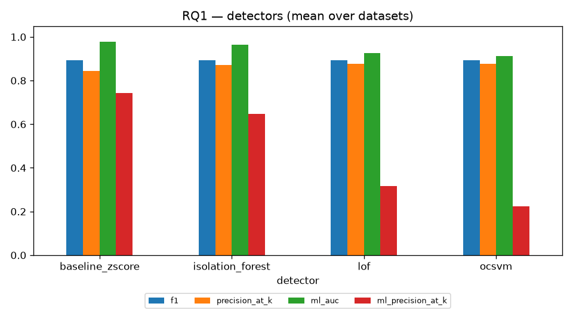
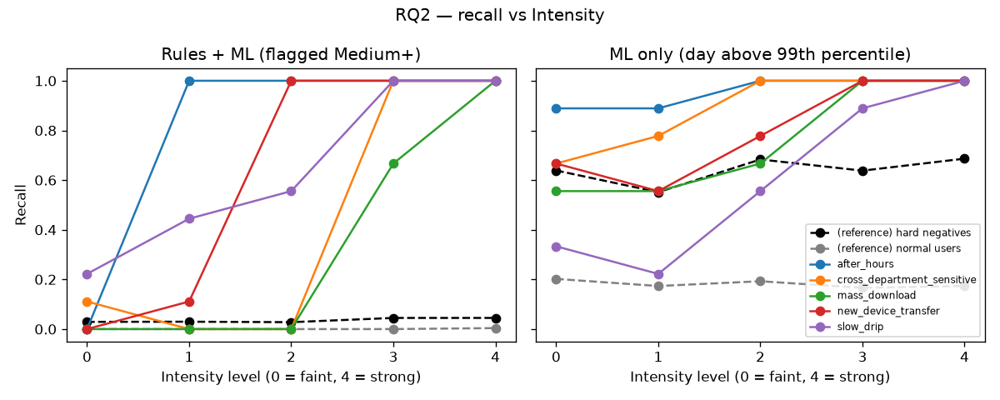
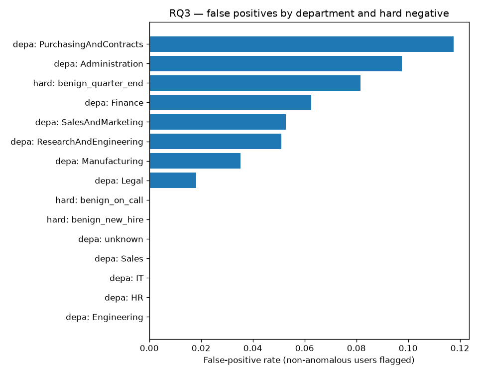

# Evaluation Report

Generated 2026-10-26T23:26:06 · mode **full** · synthetic seeds [101, 102, 103] (120 users each; fresh seeds, not used in development) · CERT r4.2: yes · detector isolation_forest · LLM ollama:gemma4 · RAG hybrid:tfidf+ollama:embeddinggemma

A user counts as **flagged** at risk level Medium or High. All numbers come from `evaluation.json` in this folder.

## 1. Headline results

| Measure | Result |
|---|---|
| Synthetic F1 (mean over seeds) | 0.948 |
| CERT r4.2 precision / recall / F1 | 0.581 / 0.971 / 0.727 |
| Demo cases passed | 8 of 8 run (0 skipped) |
| Human-in-the-loop violations | 0 in 60 cases |
| Rubric pass rate: template on synthetic-seed101 | 100% |
| Rubric pass rate: ollama:gemma4 on synthetic-seed101 | 100% |
| Rubric pass rate: ollama:llama3.2 on synthetic-seed101 | 100% |
| Rubric pass rate: template on cert_r4.2 | 100% |
| Rubric pass rate: ollama:gemma4 on cert_r4.2 | 100% |
| Rubric pass rate: ollama:llama3.2 on cert_r4.2 | 100% |

## 2. Detection accuracy

| dataset | precision | recall | f1 | precision_at_k | ml_auc | seconds |
|---|---|---|---|---|---|---|
| synthetic-seed101 | 0.882 | 1.000 | 0.938 | 1.000 | 0.936 | 0.290 |
| synthetic-seed102 | 0.882 | 1.000 | 0.938 | 0.867 | 0.963 | 0.332 |
| synthetic-seed103 | 0.938 | 1.000 | 0.968 | 0.933 | 0.992 | 0.282 |
| cert_r4.2 | 0.581 | 0.971 | 0.727 | 0.686 | 0.968 | 6.622 |

## 3. RQ1 — How do the detectors compare?

The Risk Score is 75% rule Findings, so the detector changes the combined metrics only slightly. `ml_auc` and `ml_precision_at_k` rank users by the ML score alone and isolate the detector itself.

| dataset | detector | precision | recall | f1 | precision_at_k | ml_auc | ml_precision_at_k | seconds |
|---|---|---|---|---|---|---|---|---|
| synthetic-seed101 | baseline_zscore | 0.882 | 1.000 | 0.938 | 0.933 | 0.989 | 0.867 | 0.205 |
| synthetic-seed101 | isolation_forest | 0.882 | 1.000 | 0.938 | 1.000 | 0.936 | 0.333 | 0.290 |
| synthetic-seed101 | lof | 0.882 | 1.000 | 0.938 | 1.000 | 0.952 | 0.333 | 0.210 |
| synthetic-seed101 | ocsvm | 0.882 | 1.000 | 0.938 | 1.000 | 0.890 | 0.067 | 0.192 |
| synthetic-seed102 | baseline_zscore | 0.882 | 1.000 | 0.938 | 0.933 | 0.995 | 0.867 | 0.185 |
| synthetic-seed102 | isolation_forest | 0.882 | 1.000 | 0.938 | 0.867 | 0.963 | 0.733 | 0.332 |
| synthetic-seed102 | lof | 0.882 | 1.000 | 0.938 | 0.933 | 0.967 | 0.533 | 0.215 |
| synthetic-seed102 | ocsvm | 0.882 | 1.000 | 0.938 | 0.933 | 0.895 | 0.133 | 0.199 |
| synthetic-seed103 | baseline_zscore | 0.938 | 1.000 | 0.968 | 0.933 | 0.975 | 0.800 | 0.178 |
| synthetic-seed103 | isolation_forest | 0.938 | 1.000 | 0.968 | 0.933 | 0.992 | 0.933 | 0.282 |
| synthetic-seed103 | lof | 0.938 | 1.000 | 0.968 | 0.933 | 0.948 | 0.333 | 0.214 |
| synthetic-seed103 | ocsvm | 0.938 | 1.000 | 0.968 | 0.933 | 0.905 | 0.133 | 0.193 |
| cert_r4.2 | baseline_zscore | 0.581 | 0.971 | 0.727 | 0.571 | 0.948 | 0.443 | 6.022 |
| cert_r4.2 | isolation_forest | 0.581 | 0.971 | 0.727 | 0.686 | 0.968 | 0.586 | 6.622 |
| cert_r4.2 | lof | 0.581 | 0.971 | 0.727 | 0.643 | 0.839 | 0.071 | 28.677 |
| cert_r4.2 | ocsvm | 0.581 | 0.971 | 0.727 | 0.643 | 0.964 | 0.557 | 8.457 |



## 4. RQ2 — How faint can an anomaly be before it's missed?

Recall of each scenario's users (flagged Medium+), averaged over seeds. The two **(reference)** rows apply the same test to users who should *not* be flagged, so they are false-flag rates. Compare `ml_recall` with them before crediting the ML detector with faint anomalies. Intensity values per level:

| scenario | field | level 0 | level 1 | level 2 | level 3 | level 4 |
|---|---|---|---|---|---|---|
| mass_download | mass_download_multiplier | 2 | 3 | 5 | 10 | 50 |
| after_hours | after_hours_events_per_night | 2 | 4 | 8 | 15 | 25 |
| cross_department_sensitive | cross_department_accesses_per_day | 1 | 2 | 4 | 8 | 12 |
| new_device_transfer | new_device_transfers_per_day | 2 | 4 | 6 | 10 | 30 |
| slow_drip | slow_drip_extra_per_day | 1 | 2 | 3 | 5 | 8 |

**Rules + ML (the Risk Score):**

| scenario | level 0 | level 1 | level 2 | level 3 | level 4 |
|---|---|---|---|---|---|
| (reference) hard negatives | 0.029 | 0.030 | 0.028 | 0.045 | 0.045 |
| (reference) normal users | 0.000 | 0.000 | 0.000 | 0.000 | 0.004 |
| after_hours | 0.000 | 1.000 | 1.000 | 1.000 | 1.000 |
| cross_department_sensitive | 0.111 | 0.000 | 0.000 | 1.000 | 1.000 |
| mass_download | 0.000 | 0.000 | 0.000 | 0.667 | 1.000 |
| new_device_transfer | 0.000 | 0.111 | 1.000 | 1.000 | 1.000 |
| slow_drip | 0.222 | 0.444 | 0.556 | 1.000 | 1.000 |

**ML detector alone** (user has a day above the 99th percentile of normal days):

| scenario | level 0 | level 1 | level 2 | level 3 | level 4 |
|---|---|---|---|---|---|
| (reference) hard negatives | 0.639 | 0.551 | 0.683 | 0.638 | 0.686 |
| (reference) normal users | 0.202 | 0.173 | 0.193 | 0.166 | 0.174 |
| after_hours | 0.889 | 0.889 | 1.000 | 1.000 | 1.000 |
| cross_department_sensitive | 0.667 | 0.778 | 1.000 | 1.000 | 1.000 |
| mass_download | 0.556 | 0.556 | 0.667 | 1.000 | 1.000 |
| new_device_transfer | 0.667 | 0.556 | 0.778 | 1.000 | 1.000 |
| slow_drip | 0.333 | 0.222 | 0.556 | 0.889 | 1.000 |



## 5. RQ3 — Who is flagged wrongly?

False-positive rate among non-anomalous users, by department and by hard-negative group (summed over datasets).

| group_type | group | users | flagged | fp_rate |
|---|---|---|---|---|
| department | Administration | 82 | 8 | 0.098 |
| department | Engineering | 52 | 0 | 0.000 |
| department | Finance | 64 | 4 | 0.062 |
| department | HR | 54 | 0 | 0.000 |
| department | IT | 53 | 0 | 0.000 |
| department | Legal | 55 | 1 | 0.018 |
| department | Manufacturing | 199 | 7 | 0.035 |
| department | PurchasingAndContracts | 17 | 2 | 0.118 |
| department | ResearchAndEngineering | 314 | 16 | 0.051 |
| department | Sales | 50 | 0 | 0.000 |
| department | SalesAndMarketing | 303 | 16 | 0.053 |
| department | unknown | 2 | 0 | 0.000 |
| hard_negative | benign_new_hire | 9 | 0 | 0.000 |
| hard_negative | benign_on_call | 9 | 0 | 0.000 |
| hard_negative | benign_quarter_end | 49 | 4 | 0.082 |



## 6. RQ4 — Explanation quality and hallucination

Rubric criteria are binary per case: **clear**, **evidence_based**, **actionable**, **safe** (see `src/ueba/rubric.py`). `unsupported_rate` is the share of numbers in summaries that don't appear in the case's facts. `benign_grounded_rate` is the share of innocent explanations that match a playbook explanation.

| dataset | writer | cases | rubric_pass_rate | clear | evidence_based | actionable | safe | unsupported_rate | benign_grounded_rate | fallback_rate | mean_seconds |
|---|---|---|---|---|---|---|---|---|---|---|---|
| synthetic-seed101 | template | 10 | 1.000 | 1.000 | 1.000 | 1.000 | 1.000 | 0.000 | 1.000 | 0.000 | 0.036 |
| synthetic-seed101 | ollama:gemma4 | 10 | 1.000 | 1.000 | 1.000 | 1.000 | 1.000 | 0.000 | 1.000 | 0.000 | 5.735 |
| synthetic-seed101 | ollama:llama3.2 | 10 | 1.000 | 1.000 | 1.000 | 1.000 | 1.000 | 0.000 | 1.000 | 0.000 | 2.820 |
| cert_r4.2 | template | 10 | 1.000 | 1.000 | 1.000 | 1.000 | 1.000 | 0.000 | 1.000 | 0.000 | 0.077 |
| cert_r4.2 | ollama:gemma4 | 10 | 1.000 | 1.000 | 1.000 | 1.000 | 1.000 | 0.000 | 1.000 | 0.000 | 6.517 |
| cert_r4.2 | ollama:llama3.2 | 10 | 1.000 | 1.000 | 1.000 | 1.000 | 1.000 | 0.000 | 1.000 | 0.000 | 2.841 |

Fallback reasons: none

## 7. Demo cases

| case | user | status | risk | generated_by | details |
|---|---|---|---|---|---|
| Mass download | U0084 | passed | High | ollama:gemma4 |  |
| After-hours activity | U0038 | passed | High | ollama:gemma4 |  |
| Cross-department sensitive access | U0061 | passed | High | ollama:gemma4 |  |
| Transfers from a new device | U0035 | passed | High | ollama:gemma4 |  |
| Hard negative: on-call night work | U0018 | passed | Low |  |  |
| Clean control: normal user | U0003 | passed | Low |  |  |
| CERT insider | U0002 | passed | High | ollama:gemma4 |  |
| Privacy Lint trap | U0084 | passed | High | template (fallback from trap-llm: privacy lint: malicious) |  |

## 8. Human-in-the-loop check

Checked 60 generated cases: with no Review Decision, 0 authorised a Sensitive Recommendation.

## 9. Error analysis

**synthetic-seed101**: 2 false positives, 0 false negatives.

- Rules behind false positives: {'SUSTAINED_INCREASE': 2}
- Most common rule combinations: {'SUSTAINED_INCREASE': 2}
- Missed users: none

**cert_r4.2**: 49 false positives, 2 false negatives.

- Rules behind false positives: {'AFTER_HOURS': 37, 'EXECUTABLE_TO_USB': 33, 'SUSTAINED_INCREASE': 9, 'OTHER_USER_PC': 6, 'NEW_DEVICE_TRANSFER': 5, 'NEW_USB_USER': 2}
- Most common rule combinations: {'AFTER_HOURS, EXECUTABLE_TO_USB': 20, 'AFTER_HOURS': 10, 'SUSTAINED_INCREASE, EXECUTABLE_TO_USB': 5, 'AFTER_HOURS, OTHER_USER_PC, EXECUTABLE_TO_USB': 3, 'AFTER_HOURS, NEW_DEVICE_TRANSFER': 2}
- Missed users: [{'user_id': 'U0290', 'scenario': 'cert_scenario_2', 'risk_score': 15.0, 'rules': 'EXECUTABLE_TO_USB'}, {'user_id': 'U0980', 'scenario': 'cert_scenario_2', 'risk_score': 15.0, 'rules': 'EXECUTABLE_TO_USB'}]

## 10. Limitations

- **Synthetic results reflect the generator's assumptions.** The team wrote both the scenarios and the rules. RQ2 shows where detection breaks down; perfect scores at default Intensity show only that the pipeline works.
- **CERT r4.2 is "dense"** (70 of 1,000 users), so real-world precision would be lower. The CERT rule change in experiment E2 was label-informed (docs/experiment-log.md).
- **Rubric checks are automated proxies.** The hallucination guard checks numbers, not claims. A human-rated sample is still required (REQUIREMENTS §11 Q3).
- **RQ4's automated rubric is at a ceiling.** Model differences need the blind human rating (`python -m ueba.rating`, see reports/human_rating.md).
- **Control Mapping IDs are an unverified draft (FR-11).**

## Reproduce

```bash
.venv/bin/python -m ueba.evaluate            # full
.venv/bin/python -m ueba.evaluate --quick    # smoke run
```
